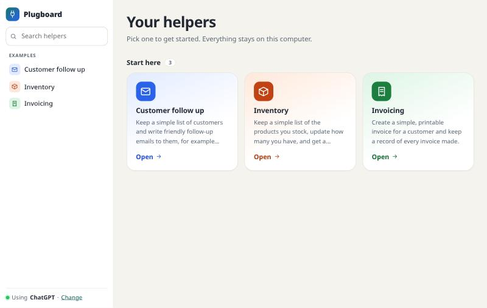
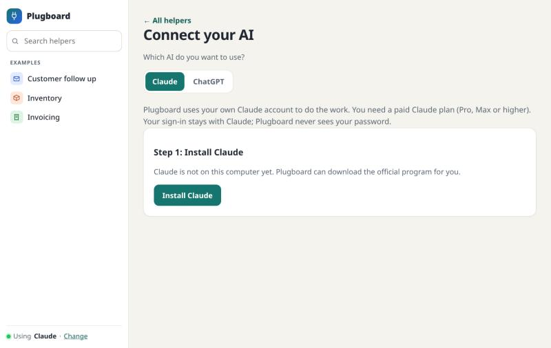
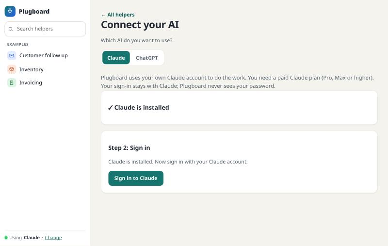
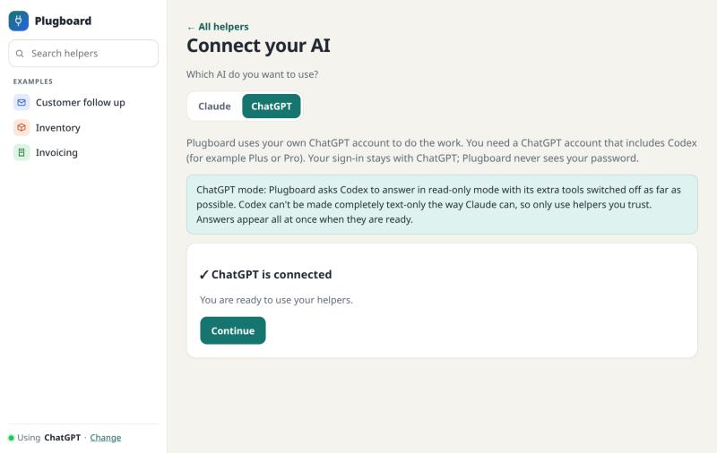
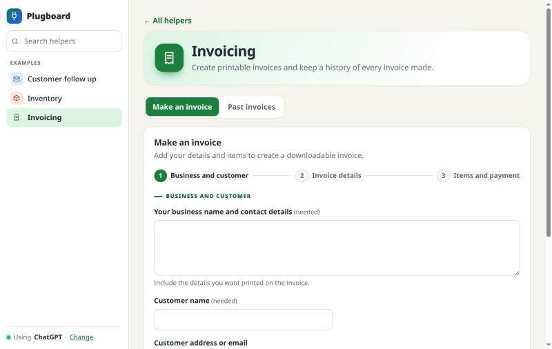
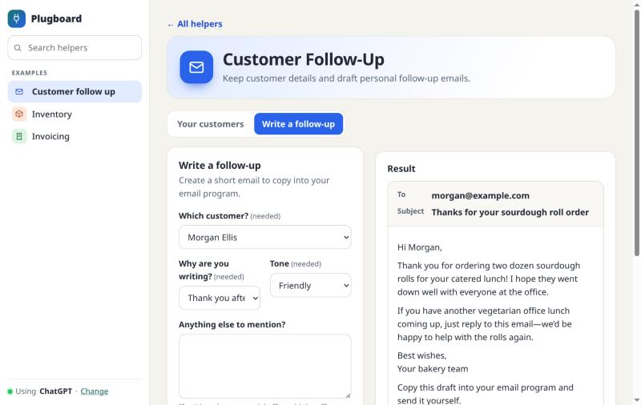

# Maginary

**Turn the AI helpers on your computer into simple screens you can click.**

If you use Claude, you may have added "skills" or "plugins" that do jobs for you, like writing invoices or
follow-up emails. Normally you use them by typing. Maginary shows each one as a form with boxes and buttons instead,
and it remembers things between uses, like your customers and your stock.

- It runs **on your own computer**. There is nothing to sign up for.
- It uses **your own Claude or ChatGPT account**, whichever you have. Maginary never sees your password.
- It is free and open source (MIT license).



---

## What you need

1. **A computer** running Windows, Mac or Linux. *(So far it has only been tried on Windows. Mac and Linux should work, but nobody has checked yet.)*
2. **A paid Claude plan** (Pro, Max or higher), **or** a **ChatGPT account that includes Codex** (for example Plus or Pro). The free Claude plan does not work.
3. **Node.js**, a free program that Maginary runs on. Step 1 below shows how to get it.

## Install and start

### Step 1: Get Node.js (once)

1. Go to **https://nodejs.org**
2. Click the big green download button and run the installer. Click "Next" until it finishes.

### Step 2: Get Maginary (once)

1. **[Click here to download Maginary as a ZIP file](https://github.com/Aryan-sk6/maginary/archive/refs/heads/main.zip).** (Or go to the [Maginary page](https://github.com/Aryan-sk6/maginary), click the green **Code** button, then **Download ZIP**.)
2. **Unpack it.** On Windows, right-click the ZIP and choose **Extract All**. Do not open Maginary from inside the ZIP, because it won't work from there.

### Step 3: Start Maginary (every time)

Open the Maginary folder and double-click the start file for your computer:

| Your computer | Double-click this file |
|---|---|
| Windows | **Start Maginary.bat** |
| Mac | **Start Maginary.command** |
| Linux | **start-maginary.sh** |

A black window opens and your web browser opens Maginary. **Keep the black window open while you use Maginary.**
To stop Maginary, close that window.

*(Windows may ask whether you really want to run the file, or say "Windows protected your PC". That is normal for files from the internet. Click **More info**, then **Run anyway** (or **Run**). See Troubleshooting if a Mac or Linux computer won't open the file.)*

### Step 4: Connect your AI (once)

The first time, Maginary asks you to connect an AI. Pick the one you have an account with, then follow the screen.
**If you have both, pick Claude.** It is the safer choice (see "Your information" below).

**Claude:**

1. Click **Install Claude** if you see it. This downloads Claude's official program and takes a minute or two.
2. Click **Sign in to Claude**. Claude's own sign-in page opens in your browser. Sign in there. If the page shows you a code, paste it into the box in Maginary.
3. When you see **Claude is connected**, click **Continue**.




**ChatGPT:**

1. Click **ChatGPT**. If Codex (OpenAI's program) isn't on your computer yet, Maginary shows a link with instructions. It can't install Codex for you. This page notices by itself once it is installed.
2. Click **Sign in to ChatGPT**. OpenAI's own sign-in page opens in your browser. Sign in there.
3. When you see **ChatGPT is connected**, click **Continue**.



You can switch at any time: click **Change** next to "Using …" at the bottom of the menu on the left.

## Using a helper

The menu on the left lists all your helpers, and you can **search** it. The first page shows the three examples as big cards.
**Every helper gets its own color, icon and layout**, so you can tell them apart at a glance.

1. **Click a helper.** Maginary shows the skills you have added to Claude, plus three examples to try:
   *Customer follow-up*, *Inventory* and *Invoicing*.
2. **The first time you open a helper, wait a moment.** Your AI designs its screen, which takes about 10 to 20 seconds with Claude and up to a minute with ChatGPT. After that the screen is saved and opens instantly.
3. **Fill in the boxes** and click the button. A line under each button tells you what it does.
4. **Watch the answer appear.** With Claude the words appear as they are written; with ChatGPT the whole answer appears at once when it is ready. You can press **Stop** at any time.

Your AI decides how each screen looks, and picks from a fixed menu, so it can never break the page:

- **Step by step.** A long form is split into short steps with a progress line. Invoicing does this.
- **A list beside a form.** Helpers that keep records show your saved list on the left, always up to date, with a small form to add or change one.
- **A form beside its result.** The answer appears next to the form instead of far below it.




Results look like what they are: an **email** looks like an email (with To and Subject), an **invoice** looks like a printed page you can download, and a **table** can be downloaded as a spreadsheet.



**Always check amounts, dates and names before you send an invoice or an email.** The AI can make mistakes.

### The three examples

| Example | What it does |
|---|---|
| **Customer follow-up** | Keeps a customer list. Pick a customer and your AI writes a friendly email for you to copy and send. |
| **Inventory** | Keeps a stock list. Press one button to see what you should reorder, as a table. |
| **Invoicing** | Fills in an invoice, works out the totals, and gives you a file to download. It also keeps a list of your invoices. |

### Your own helpers

Anything you add to Claude as a skill shows up in Maginary the next time you refresh the page.
Maginary only reads them. It never changes, moves or deletes anything in your Claude folders.

## Your information

- **Saved records** (customers, stock, invoices) live in a folder called **Maginary** inside your **Documents** folder.
  Maginary shows the exact place at the bottom of the first page. **Back this folder up** to keep your records safe.
  If your Documents folder syncs with OneDrive or iCloud, the records sync too.
- **What leaves your computer:** when you press a button, the helper's instructions and the answers you typed are sent to your AI (Claude or ChatGPT), the same as if you typed them in yourself.
  Maginary itself has no servers, no accounts and no tracking.
- **The AI is only meant to write text.** When a helper would send an email or save a file, Maginary gives you the text to send or the file to download yourself.
  - **With Claude,** the AI has no tools at all: it cannot open your files, browse the web, or send anything.
  - **With ChatGPT,** Codex can't be made completely text-only. Maginary runs it in read-only mode, in an empty temporary folder, with web search and its other tools switched off as far as Codex allows, and it ignores your own Codex settings. In our tests (on Windows) it could not read a test file. But it is **reduced access, not zero access**, so with ChatGPT only use helpers you trust (like the three examples, or ones you wrote).
- Your plan's usage limits apply. If you reach a limit, Maginary shows your AI's message and does not try to get around it.

## Troubleshooting

**"Maginary needs a free program called Node.js"**: do Step 1, then double-click the start file again.

**Nothing opened in my browser.** Look at the black window. It prints a link like `http://127.0.0.1:4567`. Copy that link into your browser.

**The black window closed straight away.** Open Maginary's folder and start it again. If the window still disappears, send the message it shows to whoever helps you.

**Windows asks if I'm sure, or says "Windows protected your PC".** This can appear for any file downloaded from the internet. Click **More info**, then **Run anyway** (or **Run**).

**My Mac says the file can't be opened.** Right-click **Start Maginary.command**, choose **Open**, then click **Open** again. If it says "permission denied", open the **Terminal** app, type `chmod +x ` (with a space at the end), drag **Start Maginary.command** and **start-maginary.sh** into the window one after the other, and press Enter. Then try again.

**Linux: the start file opens in a text editor.** Open a terminal in the Maginary folder and type `sh start-maginary.sh`.

**"Claude isn't set up on this computer yet", "Claude isn't signed in", or the same for ChatGPT.** Click **Connect your AI** and follow the steps.

**Installing Claude failed.** Check your internet connection and try again. Some work computers block the download. In that case, install Claude yourself from https://code.claude.com/docs/en/setup, then come back.

**I picked ChatGPT but Maginary can't find Codex.** Maginary can't install Codex for you. Install the Codex app or program from OpenAI (https://developers.openai.com/codex), then come back. The page notices by itself.

**The sign-in page didn't open.** Click **Open the sign-in page** in Maginary. If you can't find it, make sure your browser isn't blocking pop-ups.

**My AI says I've hit a usage limit.** Wait until the time it gives, then try again. Maginary can't change this.

**"Claude took too long to answer" (or ChatGPT).** Try again. Shorter answers are quicker.

**I want to switch between Claude and ChatGPT.** Click **Change** next to "Using …" at the bottom of the menu on the left. Screens that were already designed are kept and work with either one.

**A helper's screen asks too many questions, or looks wrong.** Close Maginary, open your **Maginary** folder in Documents, delete the folder called `recipes` inside it, and start Maginary again. Claude will design fresh screens. Your saved records are not deleted. (A new screen may word its boxes a little differently, so older records can look slightly different in lists.)

**My saved records are missing.** Check the folder shown at the bottom of Maginary's first page. Records are kept per helper, so if you rename or remove a helper in Claude, its records stay in the folder but don't show up.

**I see a line about SQLite being "experimental" in the black window.** That is normal on some versions of Node.js. You can ignore it.

## Known limits

- ChatGPT mode is newer and less strict than Claude mode (see "Your information"), and its answers arrive all at once instead of word by word.
- Maginary can install Claude for you, but not Codex.
- You can upload text files only (like `.txt`, `.csv`, `.md`), up to 200 KB.
- Maginary has not been tried on Mac or Linux yet.
- Saved lists show the newest 500 records.
- Maginary is not made by, or endorsed by, Anthropic or OpenAI. "Claude" is a trademark of Anthropic.

---

## For developers

```bash
node src/cli.ts          # same as double-clicking the start file (npm start does this too)
npm test                 # runs all tests; needs only Node.js 22.18 or newer
npm install              # only needed for the type check and the build
npm run typecheck
```

- `src/reader.ts` finds skills, commands and plugins (read-only). `src/recipe.ts` defines the screen format and its checks.
  `public/look.js` is the fixed menu of 8 colors and 17 icons. The screen format also lets the AI pick a layout (`form`, `split`, `data` or `steps`), group fields into sections, and choose how a result is shown (`plain`, `document` or `email`). All of it is optional and checked, and anything off the menu is ignored.
  `src/generator.ts` asks your AI for a screen and caches it. `public/renderer.js` draws a fixed set of components.
  `src/runner.ts` runs a button press through an adapter: `src/claude.ts` (Claude Code) or `src/codex.ts` (Codex).
  `src/providers.ts` lists the two AIs and `src/setup.ts` handles install and sign-in. `src/store.ts` is the SQLite store (Node's built-in `node:sqlite`).
- The AI never writes screen code. It returns JSON that is checked against a fixed format, and anything invalid falls back to a plain text box.
- Plugin text is treated as untrusted data. Claude runs with no tools (`--tools ""`, `--safe-mode`).
  Codex has no such switch, so `codexArgs()` in `src/codex.ts` layers: read-only sandbox, ephemeral, user config and rules ignored, web search off, an empty temporary working folder, and every tool-giving feature from `DISABLED_FEATURES` switched off.
  The remaining Codex tools are reduced, not removed; see the comment at the top of that file for what was and wasn't checked.
- Set `MAGINARY_DATA` to keep records somewhere else. Set `MAGINARY_CLAUDE_PATH` or `MAGINARY_CODEX_PATH` to use a specific program.

License: MIT. See `LICENSE`.
