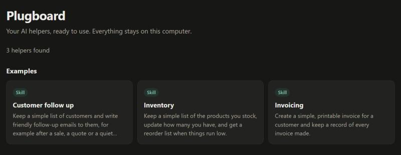
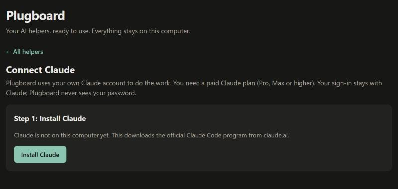
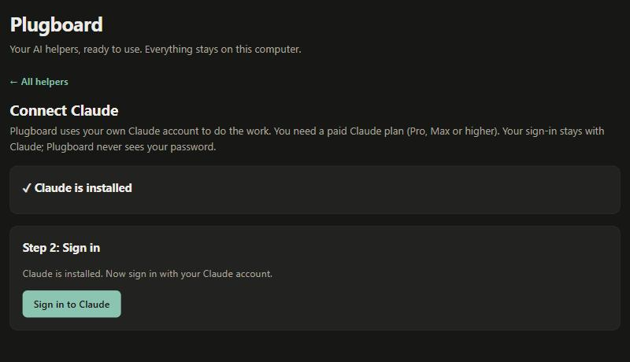
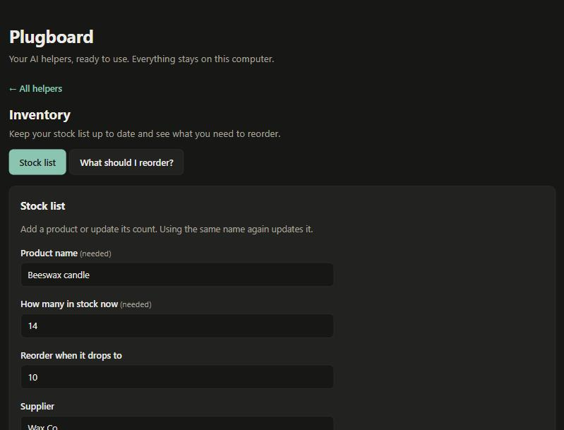
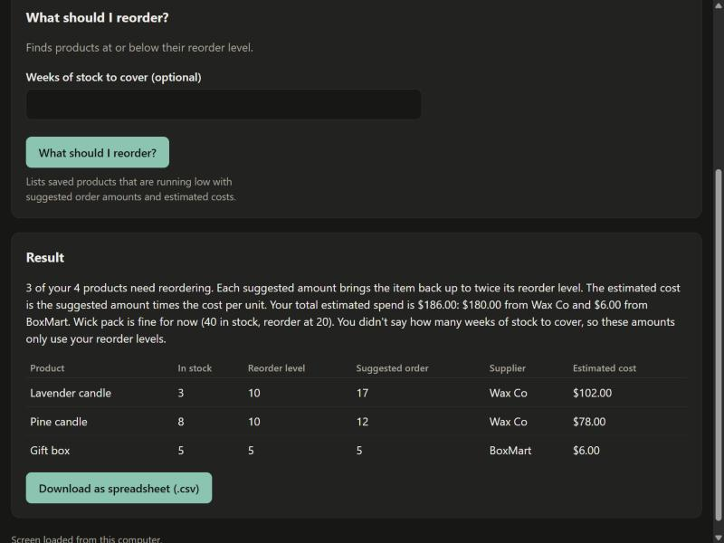

# Plugboard

**Turn the AI helpers on your computer into simple screens you can click.**

If you use Claude, you may have added "skills" or "plugins" that do jobs for you, like writing invoices or
follow-up emails. Normally you use them by typing. Plugboard shows each one as a form with boxes and buttons instead,
and it remembers things between uses, like your customers and your stock.

- It runs **on your own computer**. There is nothing to sign up for.
- It uses **your own Claude account**. Plugboard never sees your password.
- It is free and open source (MIT license). *Plugboard is a working name.*



---

## What you need

1. **A computer** running Windows, Mac or Linux. *(So far it has only been tried on Windows. Mac and Linux should work, but nobody has checked yet.)*
2. **A paid Claude plan** (Pro, Max or higher). The free Claude plan does not work.
3. **Node.js**, a free program that Plugboard runs on. Step 1 below shows how to get it.

## Install and start

### Step 1: Get Node.js (once)

1. Go to **https://nodejs.org**
2. Click the big green download button and run the installer. Click "Next" until it finishes.

### Step 2: Get Plugboard (once)

1. Download Plugboard as a ZIP file. (On GitHub, click the green **Code** button, then **Download ZIP**.)
2. **Unpack it.** On Windows, right-click the ZIP and choose **Extract All**. Do not open Plugboard from inside the ZIP, because it won't work from there.

### Step 3: Start Plugboard (every time)

Open the Plugboard folder and double-click the start file for your computer:

| Your computer | Double-click this file |
|---|---|
| Windows | **Start Plugboard.bat** |
| Mac | **Start Plugboard.command** |
| Linux | **start-plugboard.sh** |

A black window opens and your web browser opens Plugboard. **Keep the black window open while you use Plugboard.**
To stop Plugboard, close that window.

*(Windows may ask whether you really want to run the file, or say "Windows protected your PC". That is normal for files from the internet. Click **More info**, then **Run anyway** (or **Run**). See Troubleshooting if a Mac or Linux computer won't open the file.)*

### Step 4: Connect Claude (once)

The first time, Plugboard asks you to connect Claude. Just follow the screen:

1. Click **Install Claude** if you see it. This downloads Claude's official program and takes a minute or two.
2. Click **Sign in to Claude**. Claude's own sign-in page opens in your browser. Sign in there. If the page shows you a code, paste it into the box in Plugboard.
3. When you see **Claude is connected**, click **Continue**.




## Using a helper

1. **Click a helper** on the first page. Plugboard shows the skills you have added to Claude, plus three examples to try:
   *Customer follow-up*, *Inventory* and *Invoicing*.
2. **The first time you open a helper, wait a moment.** Claude designs its screen, which takes about 10 to 20 seconds. After that the screen is saved and opens instantly.
3. **Fill in the boxes** and click the button. A line under each button tells you what it does.
4. **Watch the answer appear.** You can press **Stop** at any time.



Answers show up as text, as a table (with a button to download it as a spreadsheet), or as a file you can download.



**Always check amounts, dates and names before you send an invoice or an email.** The AI can make mistakes.

### The three examples

| Example | What it does |
|---|---|
| **Customer follow-up** | Keeps a customer list. Pick a customer and Claude writes a friendly email for you to copy and send. |
| **Inventory** | Keeps a stock list. Press one button to see what you should reorder, as a table. |
| **Invoicing** | Fills in an invoice, works out the totals, and gives you a file to download. It also keeps a list of your invoices. |

### Your own helpers

Anything you add to Claude as a skill shows up in Plugboard the next time you refresh the page.
Plugboard only reads them. It never changes, moves or deletes anything in your Claude folders.

## Your information

- **Saved records** (customers, stock, invoices) live in a folder called **Plugboard** inside your **Documents** folder.
  Plugboard shows the exact place at the bottom of the first page. **Back this folder up** to keep your records safe.
  If your Documents folder syncs with OneDrive or iCloud, the records sync too.
- **What leaves your computer:** when you press a button, the helper's instructions and the answers you typed are sent to Claude, the same as if you typed them into Claude yourself.
  Plugboard itself has no servers, no accounts and no tracking.
- **The AI can only write text.** It cannot open your files, browse the web, or send emails. When a helper would send an email or save a file, Plugboard gives you the text to send or the file to download yourself.
- Your Claude plan's usage limits apply. If you reach a limit, Plugboard shows Claude's message and does not try to get around it.

## Troubleshooting

**"Plugboard needs a free program called Node.js"**: do Step 1, then double-click the start file again.

**Nothing opened in my browser.** Look at the black window. It prints a link like `http://127.0.0.1:4567`. Copy that link into your browser.

**The black window closed straight away.** Open Plugboard's folder and start it again. If the window still disappears, send the message it shows to whoever helps you.

**Windows asks if I'm sure, or says "Windows protected your PC".** This can appear for any file downloaded from the internet. Click **More info**, then **Run anyway** (or **Run**).

**My Mac says the file can't be opened.** Right-click **Start Plugboard.command**, choose **Open**, then click **Open** again. If it says "permission denied", open the **Terminal** app, type `chmod +x ` (with a space at the end), drag **Start Plugboard.command** and **start-plugboard.sh** into the window one after the other, and press Enter. Then try again.

**Linux: the start file opens in a text editor.** Open a terminal in the Plugboard folder and type `sh start-plugboard.sh`.

**"Claude isn't set up on this computer yet" or "Claude isn't signed in".** Click **Connect Claude** and follow the steps.

**Installing Claude failed.** Check your internet connection and try again. Some work computers block the download. In that case, install Claude yourself from https://code.claude.com/docs/en/setup, then come back.

**The sign-in page didn't open.** Click **Open the sign-in page** in Plugboard. If you can't find it, make sure your browser isn't blocking pop-ups.

**Claude says you've hit a usage limit.** Wait until the time it gives, then try again. Plugboard can't change this.

**"Claude took too long to answer".** Try again. Shorter answers are quicker.

**A helper's screen asks too many questions, or looks wrong.** Close Plugboard, open your **Plugboard** folder in Documents, delete the folder called `recipes` inside it, and start Plugboard again. Claude will design fresh screens. Your saved records are not deleted. (A new screen may word its boxes a little differently, so older records can look slightly different in lists.)

**My saved records are missing.** Check the folder shown at the bottom of Plugboard's first page. Records are kept per helper, so if you rename or remove a helper in Claude, its records stay in the folder but don't show up.

**I see a line about SQLite being "experimental" in the black window.** That is normal on some versions of Node.js. You can ignore it.

## Known limits

- ChatGPT / Codex is not supported yet. Only Claude works.
- You can upload text files only (like `.txt`, `.csv`, `.md`), up to 200 KB.
- Plugboard has not been tried on Mac or Linux yet.
- Saved lists show the newest 500 records.
- Plugboard is not made by, or endorsed by, Anthropic or OpenAI. "Claude" is a trademark of Anthropic.

---

## For developers

```bash
node src/cli.ts          # same as double-clicking the start file (npm start does this too)
npm test                 # runs all tests; needs only Node.js 22.18 or newer
npm install              # only needed for the type check and the build
npm run typecheck
```

- `src/reader.ts` finds skills, commands and plugins (read-only). `src/recipe.ts` defines the screen format and its checks.
  `src/generator.ts` asks Claude for a screen and caches it. `public/renderer.js` draws a fixed set of components.
  `src/runner.ts` runs a button press through `src/claude.ts`. `src/store.ts` is the SQLite store (Node's built-in `node:sqlite`).
- The AI never writes screen code. It returns JSON that is checked against a fixed format, and anything invalid falls back to a plain text box.
- Plugin text is treated as untrusted data. The AI runs with no tools (`--tools ""`, `--safe-mode`).
- Set `PLUGBOARD_DATA` to keep records somewhere else. Set `PLUGBOARD_CLAUDE_PATH` to use a specific `claude` program.
- The Codex adapter in `src/runner.ts` is a labelled stub.

License: MIT. See `LICENSE`.
